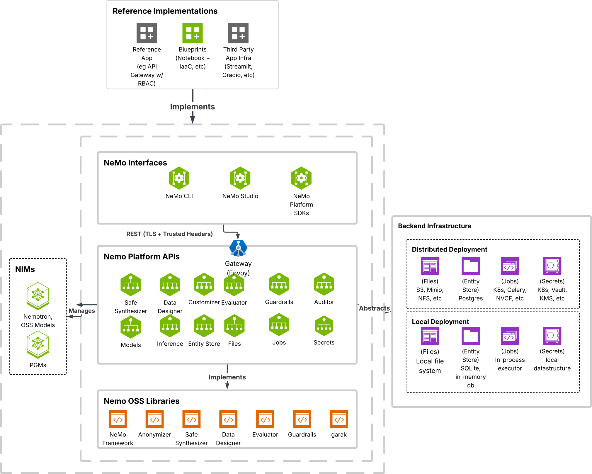

# Practicing NVIDIA NeMo Microservices

Personal development roadmap and hands-on notes for working with [NVIDIA NeMo Microservices](https://docs.nvidia.com/nemo/microservices/latest/index.html). Each folder is a self-contained exercise with its own sources and README.



## Contents

| Folder | Description |
|---|---|
| [`tool-calling/`](tool-calling/README.md) | Fine-tuning, inference, and evaluation of LLM tool calling with NeMo Microservices (data prep, fine-tuning, evaluation, and safety guardrails notebooks). |
| [`Docs/`](Docs) | Supporting docs, e.g. a [local Minikube + GPU setup log](Docs/minikube-local-gpu-setup.md) for validating Kubernetes deployment plumbing before using cloud GPUs. |

## Getting started

Each exercise folder has its own `requirements.txt` and setup instructions. For example:

```bash
cd tool-calling
python -m venv .venv && source .venv/bin/activate
pip install -r requirements.txt
cp config_example.py    # fill in your own credentials/endpoints
jupyter lab
```

`config.py` files are gitignored since they hold local credentials — copy the matching `config_example.py` and fill in your own values.

## Status

Work in progress; new exercises and notes are added as I go through the NeMo microservices stack.
