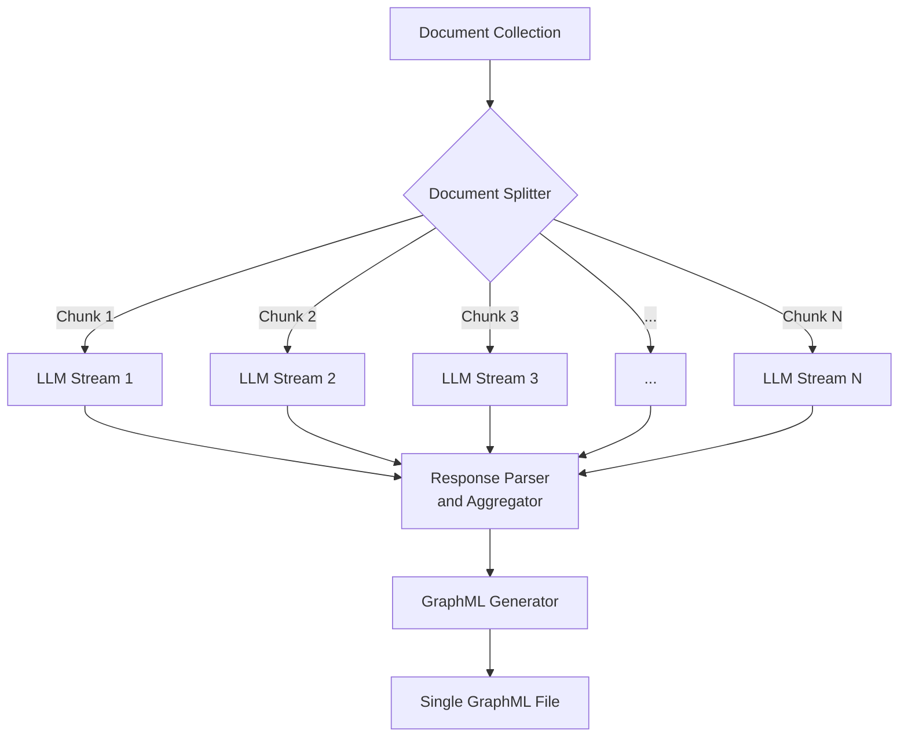
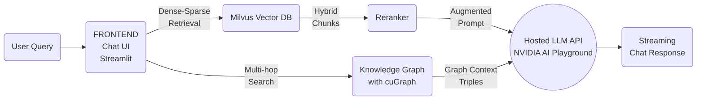
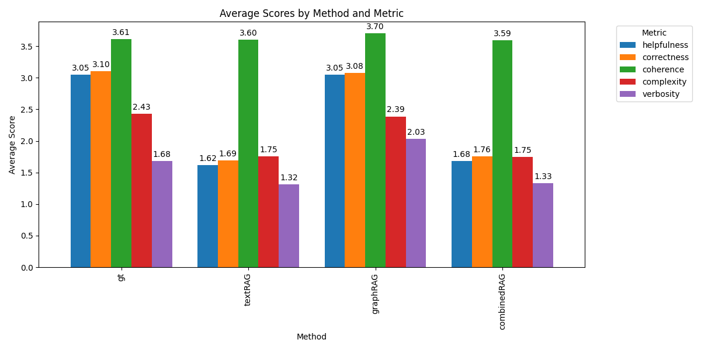

# Knowledge Graphs for RAG with NVIDIA AI Foundation Models and Endpoints

This repository implements a GPU-accelerated pipeline for creating and querying knowledge graphs using Retrieval-Augmented Generation (RAG). Our approach leverages NVIDIA's AI technologies and RAPIDS ecosystem to process large-scale datasets efficiently.

## Overview

This project demonstrates:
- Creation of knowledge graphs from various document sources
- Provides a simple script to download research papers from Arxiv for a given topic
- GPU-accelerated graph processing and analysis using NVIDIA's RAPIDS Graph Analytics library (cuGraph): https://github.com/rapidsai/cugraph
- Hybrid semantic search combining keyword and dense vector approaches
- Integration of knowledge graphs into RAG workflows
- Visualization of the knowledge graph through [Gephi-Lite](https://github.com/gephi/gephi-lite), an open-source web app for visualization of large graphs
- Comprehensive evaluation metrics using NVIDIA's Nemotron-4 340B model for synthetic data generation and reward scoring

## Technologies Used

- **Frontend**: Streamlit
- **Graph Representation and Optimization**: cuGraph (RAPIDS), NetworkX
- **Vector Database**: Milvus
- **LLM Models**:
  - NVIDIA AI Playground hosted models for graph creation and querying, providing numerous instruct-fine-tuned options
  - NVIDIA AI Playground hosted Nemotron-4 340B model for synthetic data generation and evaluation reward scoring

## Architecture Diagram

Here is how the ingestion system is designed, by leveraging a high throughput hosted LLM deployment which can process multiple document chunks in parallel. The LLM can optionally be fine-tuned for triple extraction, thereby requiring a shorter prompt and enabling greater accuracy and optimized inference.



Here's how the inference system is designed, incorporating both hybrid dense-vector search and sparse keyword-based search, reranking, and Knowledge Graph for multi-hop search:



This architecture shows how the user query is processed through both the Milvus Vector DB for traditional retrieval and the Knowledge Graph with cuGraph for multi-hop search. The results from both are then used to augment the prompt sent to the NVIDIA AI Playground backend.

## Authentication: bring your own key

There is no shared API key. Each user pastes their own NVIDIA API key (free at [build.nvidia.com](https://build.nvidia.com)) into the sidebar:

- The backend verifies the key with NVIDIA once (then caches the result) and uses it for all of that user's LLM calls, so usage is billed to the user's own account.
- The key is kept only in the browser session (Streamlit session state) and sent to the backend in the `X-NVIDIA-API-Key` header. It is never written to disk or logged.
- Each key maps to a private **workspace** (`HMAC(WORKSPACE_SECRET, key)`) holding the user's uploads, generated CSVs, the knowledge graph and a dedicated Milvus collection. The same key reopens the same workspace later.

For local development you can set `ALLOW_SERVER_KEY=true` and `NVIDIA_API_KEY` in `.env` so the UI works without entering a key. Never enable this on a public deployment.

## Run locally (development)

Requires Python 3.10 and Docker (for Milvus).

```bash
cd knowledge_graph_rag
cp .env.example .env          # then set WORKSPACE_SECRET
uv venv --python 3.10 .venv && source .venv/bin/activate
uv pip install -r requirements.txt

docker compose up -d standalone   # Milvus (+ etcd, MinIO) on localhost:19530

cd backend && python server.py    # API on http://localhost:8000 (docs at /docs)
# in another terminal
cd frontend && streamlit run ui.py
```

Open http://localhost:8501, enter your API key in the sidebar, upload PDFs and click **Process Documents**. Only text from PDFs is supported. It can be extended to other file formats with the Unstructured.io loader in LangChain.

## Deploy

The whole stack runs from `docker-compose.yaml` on a single machine: Milvus, the FastAPI backend, the Streamlit frontend and an optional Caddy HTTPS proxy. No GPU is needed because the LLMs are NVIDIA-hosted and the BGE-M3 embeddings run on CPU. Plan for **8 GB RAM minimum (16 GB recommended)**; e.g. a Hetzner CPX31/CX42 VPS.

```bash
cp .env.example .env
# set WORKSPACE_SECRET (python -c "import secrets; print(secrets.token_hex(32))")
# set DOMAIN=kg.example.com and point its DNS A record at the server

docker compose --profile https up -d --build
```

- **HTTPS:** Caddy serves the UI at `https://$DOMAIN` with automatic Let's Encrypt certificates (ports 80/443 must be open). Without the `https` profile, the UI is only bound to `127.0.0.1:8501`. Set `FRONTEND_BIND=0.0.0.0` to expose it directly over plain HTTP.
- **Internal only:** the backend has no published port; only the frontend can reach it. Milvus and MinIO are bound to localhost.
- **Data:** workspaces live in the `app-data` volume, Milvus in `./volumes/`, and model weights in `hf-cache`. The first document processing or chat downloads BGE-M3 and the reranker (~2.5 GB) once.
- **Models:** NVIDIA retires hosted models regularly. If requests fail with 404/410, update `LLM_MODELS` / `EVAL_EMBED_MODEL` in `.env` from [build.nvidia.com/models](https://build.nvidia.com/models) and `docker compose up -d`.
- **Managed Milvus:** to use Zilliz Cloud instead of the bundled Milvus, set `MILVUS_URI` and `MILVUS_TOKEN` in `.env` and remove the `MILVUS_URI` override and the `standalone` dependency from the `backend` service.

Known limits: there is no per-user rate limiting, and each backend process holds the embedding models in memory (~3–4 GB), so run a single backend container.

## Pipeline Components

1. **Data Ingestion**:
   - ArXiv paper downloader
   - PDF upload into a private per-user workspace
2. **Knowledge Graph Creation**:
   - Uses the API Catalog models through the LangChain NVIDIA AI Endpoints interface
3. **Graph Representation**: cuGraph + RAPIDS + NetworkX
4. **Semantic Search**: Milvus 2.4.x for hybrid (keyword + dense vector) search
5. **RAG Integration**: Custom workflow incorporating knowledge graph retrieval
6. **Evaluation**: Comparison of different RAG approaches using Nemotron-4 340B model

## Evaluation Metrics

We've implemented comprehensive evaluation metrics using NVIDIA's Nemotron-4 340B model, which is designed for synthetic data generation and reward scoring. Our evaluation compares different RAG approaches across five key attributes:

1. **Helpfulness**: Overall helpfulness of the response to the prompt.
2. **Correctness**: Inclusion of all pertinent facts without errors.
3. **Coherence**: Consistency and clarity of expression.
4. **Complexity**: Intellectual depth required to write the response.
5. **Verbosity**: Amount of detail included in the response, relative to what is asked for in the prompt.

## Evaluation Results

We compared four RAG approaches on a small representative dataset using the NeMoTron-340B reward model:



Key takeaways:
- Graph RAG significantly outperforms traditional Text RAG.
- Combined Text and Graph RAG shows promise but doesn't consistently beat the ground truth yet. This may be due to the way we structure the augmented prompt for the LLM and needs more experimentation.
- Our approach improves on verbosity and coherence compared to ground truth.

While we're not beating long-context ground truth across the board, these results show the potential of integrating knowledge graphs into RAG systems. We're particularly excited about the improvements in verbosity and coherence. Next steps include refining how we combine text and graph retrieval to get the best of both worlds.

## Component Swapping

All components are designed to be swappable. Here are some options:

- **Frontend**: The current Streamlit implementation can be replaced with other web frameworks.
- **Retrieval**: The embedding model and reranker model being used for semantic search can be swapped to use other models for higher performance. The number of entities retrieved prior to reranking can also be changed. The chunk size for documents can be changed.
- **Vector DB**: While we use Milvus, it can be replaced with options like ChromaDB, Pinecone, FAISS, etc. Milvus is designed to be highly performant and scale on GPU infrastructure.
- **Backend**:
  - Cloud Hosted: Currently uses NVIDIA AI Playground APIs, but can be deployed in a private DGX Cloud or AWS/Azure/GCP with NVIDIA GPUs and LLMs.
  - On-Prem/Locally Hosted: Smaller models like Llama2-7B or Mistral-7B can be run locally with appropriate hardware. Fine-tuning can also be done for the purpose of a specific model designed for triple extraction for a given use-case.

## Future Work

- Dynamic information incorporation into knowledge graphs (continuous update of knowledge graphs)
- Further refinement of evaluation metrics and combined semantic-graphRAG pipeline
- Investigating the impact of different graph structures and queries on RAG performance (single/multi-hop retrieval, BFS/DFS, etc)
- Expanding support for various document types and formats (multimodal RAG with knowledge graphs)
- Fine-tuning the Nemotron-4 340B model for domain-specific evaluations

## Contributing

Please create a merge request to this repository, our team appreciates any and all contributions that add features! We will review and get back as soon as possible.

## Acknowledgements

This project utilizes NVIDIA's AI technologies, including the Nemotron-4 340B model, and the RAPIDS ecosystem. We thank the open-source community for their invaluable contributions to the tools and libraries used in this project.